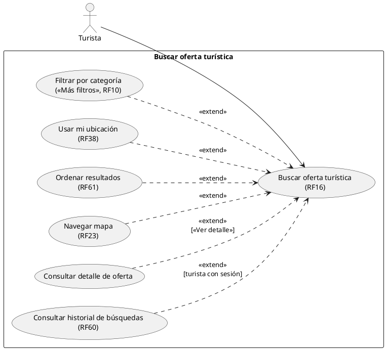
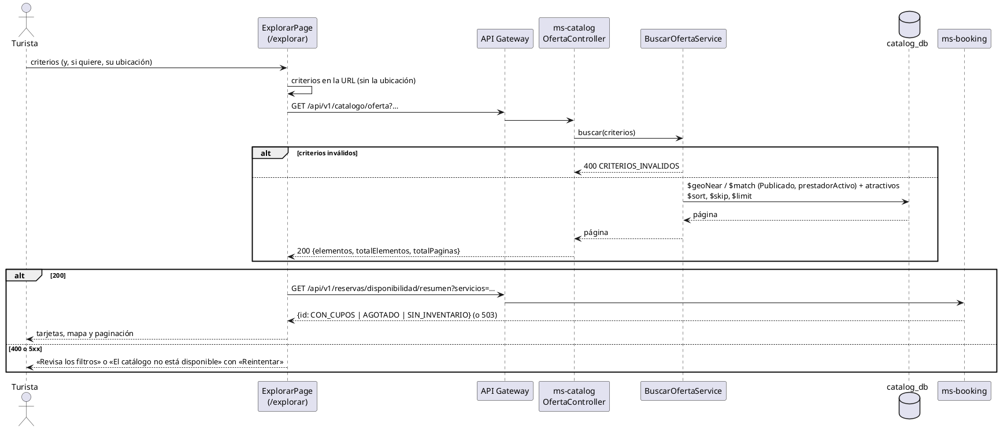

# Subsistema «Buscar oferta turística»: «Buscar oferta turística»

Fase de Construcción (RUP). Caso de uso implementado antes del plan del 60 % (DEC-54) y especificado en la revisión del 2026-11-12, que cierra HC1 para RF16, RF23, RF38, RF50 y RF61. Describe lo que hace el prototipo; no agrega reglas.
- **Pantallas:** WF-04 «Inicio y búsqueda» (`/`) y WF-05 «Exploración: mapa y resultados» (`/explorar`, con los filtros, el orden y la página en la URL).
- **Requisitos:** citados de `docs/srs/especificacion de requisitos.pdf`.
- **Decisiones:** en `docs/trazabilidad.md` («Buscar oferta turística — decisiones de búsqueda», 1 a 6; filas de WF-04 y WF-05) y en [ADR-004](../sad/adr/ADR-004-busqueda-combinada.md).
- **Contrato HTTP:** en [`sad/api/ms-catalog.md`](../sad/api/ms-catalog.md), secciones «Búsqueda pública» y «Opciones de "Más filtros"»; la disponibilidad de las tarjetas, en [`sad/api/ms-booking.md`](../sad/api/ms-booking.md) («Disponibilidad»).

| Campo | Valor |
|---|---|
| **Caso de uso** | «Buscar oferta turística», con las extensiones «Filtrar por categoría» («Más filtros»), «Usar mi ubicación», «Ordenar resultados» y «Navegar mapa» |
| **Actores** | Turista (y cualquier visitante sin sesión) |
| **Requisitos que traza** | RF16, RF23, RF38, RF50, RF27 (filtro), RF61 (parcial), RF37 (precio en la tarjeta), RF10 («Más filtros»), RF33 (estado del atractivo), RF11 (disponibilidad de las tarjetas); RNF02, RNF04 |
| **Nivel** | Objetivo de usuario |
| **Alcance** | `ms-catalog` (`catalog_db.servicios` y `atractivos`); `ms-booking` para la disponibilidad de las tarjetas |

## Reglas de negocio (citadas del SRS)

- **RF16:** «El sistema debe permitir al Turista buscar servicios y atractivos utilizando filtros combinables de categoría, precio máximo y ubicación, mostrando los resultados en una lista paginada de 10 elementos o menos por vista.»
- **RF23:** mapa interactivo con marcadores georreferenciados que despliega «el nombre y una imagen miniatura al hacer clic sobre el marcador».
- **RF38:** distancia aproximada en línea recta entre la ubicación del turista, «si la comparte», y cada resultado.
- **RF50 y RF27:** filtro por condiciones de accesibilidad (movilidad reducida, visual, auditiva): solo los que las declararon.
- **RF61:** ordenar por calificación promedio, precio (en las dos direcciones) o distancia.
- **RF22:** los servicios de un prestador Inactivo no aparecen en las búsquedas públicas.

Reglas que el SRS no fija y que decidió el equipo (`docs/trazabilidad.md`):
- **Decisiones 1 a 6:** los atractivos aparecen junto con los servicios; la categoría y el precio máximo los dejan fuera; al ordenar por precio, lo que no tiene precio va al final; los atractivos cerrados o en mantenimiento aparecen con su estado; la accesibilidad aplica a servicios y atractivos.
- **«Más filtros»** (adición del equipo a WF-05): filtros propios de cada categoría, a partir de los campos de RF10; las opciones salen de los servicios publicados.
- **Ubicación (RF38):** se pide solo al pulsar «Centrar en mi ubicación», vive solo en memoria (nunca en la URL ni en el almacenamiento del navegador) y no se guarda en el historial.
- **Orden por defecto:** distancia con ubicación; nombre sin ella. Ordenar por nombre es una ampliación (la API lo soporta).

## Diagrama de casos de uso

- «Consultar historial de búsquedas» tiene su propio [CU](CU-consultar-historial-busquedas.md); «Consultar detalle de oferta», el [suyo](CU-consultar-detalle-oferta.md).

## CU «Buscar oferta turística» (RF16)

**Actor:** Turista o visitante sin sesión.

**Precondiciones:** ninguna; la búsqueda es pública y no necesita token.

**Flujo básico:**
1. El actor escribe un texto en la barra de búsqueda del inicio (WF-04) o elige una categoría de «Explora por categoría», o abre «Búsqueda» en la navegación.
2. El sistema lleva a `/explorar` con los criterios en la URL y consulta `GET /api/v1/catalogo/oferta`.
3. ms-catalog devuelve los servicios Publicados de prestadores activos y los atractivos que cumplen los criterios, en páginas de 10.
4. El sistema muestra «Resultados en Santa Marta (N lugares encontrados)» (en una región `aria-live`), las tarjetas (imagen, nombre, descripción corta, precio «desde» en COP, distancia si hay ubicación, iconos de accesibilidad y, en los atractivos, su estado operativo) y los marcadores de la página en el mapa.
5. Para los servicios de la página, el sistema consulta una vez `GET /api/v1/reservas/disponibilidad/resumen` y muestra «Disponible esta semana», «Agotado los próximos 7 días» o «Sin fechas» (solo Tour y Alojamiento; «—» si ms-booking no responde).
6. El actor cambia el texto, el precio máximo, la accesibilidad o la página y pulsa «Aplicar filtros»; el sistema vuelve al paso 2 con la URL nueva.

**Extensión «Filtrar por categoría» («Más filtros»):**
1. El actor abre «Más filtros» y elige una categoría.
2. El sistema carga las opciones de esa categoría (`GET /api/v1/catalogo/filtros?categoria=`) y muestra solo las que devuelven resultados: servicios incluidos, huéspedes y tipo de habitación (Alojamiento); opción vegetariana y tipo de cocina (Gastronomía); nivel de dificultad y duración máxima (Tour); tipo de vehículo o equipo (Alquiler de equipos).
3. Al aplicar, la búsqueda solo trae servicios de esa categoría. En Alojamiento, huéspedes, tipo de habitación y precio máximo los debe cumplir una misma unidad, y el precio de la tarjeta es el menor de las unidades que cumplen.

**Extensión «Usar mi ubicación»:**
1. El actor pulsa «Centrar en mi ubicación» y el navegador pide el permiso.
2. Con el permiso, el sistema envía `lat` y `lng` (solo en la petición), habilita la distancia máxima y el orden por distancia, y muestra la distancia en cada tarjeta y el marcador «Tu ubicación».

**Extensión «Ordenar resultados»:** el actor elige «Menor distancia» (con ubicación), «Precio: menor a mayor», «Precio: mayor a menor» o «Nombre». «Calificación» y «Menor afluencia» aparecen deshabilitados (RF17 y RF39 no están implementados).

**Extensión «Navegar mapa»:** el actor pulsa un marcador; el mapa muestra una ventana con la miniatura y el nombre (RF23), el corazón de favoritos (solo turistas) y «Ver detalle», y resalta la tarjeta correspondiente.

**Flujos alternos:**
- **FA1. Sin resultados.** El sistema lo dice y ofrece «Quitar filtros».
- **FA2. Página fuera de rango.** El sistema ofrece «Ir a la primera página».
- **FA3. Criterios inválidos.** 400 `CRITERIOS_INVALIDOS` («Revisa los filtros»). Una URL con filtros de «Más filtros» de otra categoría o con valores inválidos se limpia antes de consultar, sin error.
- **FA4. Sin ubicación.** Permiso denegado, ubicación no disponible o tiempo agotado: aviso en `role="status"`; la distancia y el orden por distancia siguen deshabilitados y la búsqueda funciona sin ellos. Lejos de Santa Marta (más de 60 km), la ubicación se usa para la distancia y el orden, no para el encuadre del mapa, y el sistema lo avisa.
- **FA5. Catálogo no disponible.** 502, 503 o 504 (o `SERVICIO_NO_DISPONIBLE`): «El catálogo no está disponible» con «Reintentar».
- **FA6. Opciones de «Más filtros» no disponibles.** Aviso con «Reintentar»; los demás filtros siguen funcionando.

**Postcondiciones:** ninguna en el catálogo; el CU no cambia datos. Con la sesión de un turista, la búsqueda que llega con éxito se registra aparte en su historial, sin coordenadas (CU [«Consultar historial de búsquedas»](CU-consultar-historial-busquedas.md)).

## Criterios de aceptación derivados

| # | Criterio | Prueba |
|---|---|---|
| C1 | Solo servicios Publicados de prestadores activos, más los atractivos; páginas de 10 o menos | `BuscarOfertaServiceTest`, `OfertaApiIntegracionTest`, `VisibilidadPrestadorApiIntegracionTest` |
| C2 | Filtros combinables (texto, categoría, precio máximo, distancia y accesibilidad) con las decisiones 1 a 6 | `BuscarOfertaServiceTest`, `ResultadosBusquedaTest`, `OfertaApiIntegracionTest` |
| C3 | Criterios inválidos → 400 `CRITERIOS_INVALIDOS` | `CriteriosBusquedaTest`, `OfertaApiIntegracionTest` |
| C4 | «Más filtros»: cada filtro exige su categoría; en Alojamiento, una misma unidad; opciones tomadas de los datos | `FiltrosCategoriaTest`, `ParametrosFiltrosCategoriaTest`, `MasFiltrosApiIntegracionTest`, `MasFiltrosEquivalenciaTest`, `ConsultarOpcionesFiltroServiceTest` |
| C5 | Distancia en línea recta y orden por distancia o precio | `BuscarOfertaServiceTest`, `OfertaApiIntegracionTest`, `geo.test.ts` |
| C6 | Pantalla: filtros en la URL, estados de carga, vacío y error, ubicación solo en memoria | `explorar.test.tsx`, `masFiltros.test.tsx`, `criteriosMasFiltros.test.ts`, `explorarFalloCarga.test.tsx`, `explorarDiferido.test.tsx`, `inicio.test.tsx` |
| C7 | Mapa con marcadores, ventana con miniatura y nombre, resaltado con la tarjeta | `explorarMapa.test.tsx` |
| C8 | Disponibilidad de las tarjetas con una consulta por página | `disponibilidadTarjetas.test.tsx` |

## Secuencia

## Fuera de alcance

- Orden por calificación (RF17) y por afluencia, y el indicador de afluencia (RF39).
- Búsqueda sin distinguir tildes en el catálogo (punto 5 de «Pendientes para el SAD»).
- Criterio definitivo de «Destacados esta semana» (provisional; «Pendientes»).
