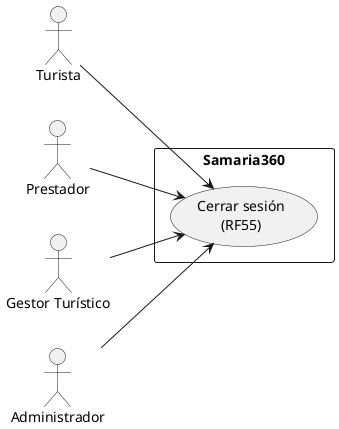
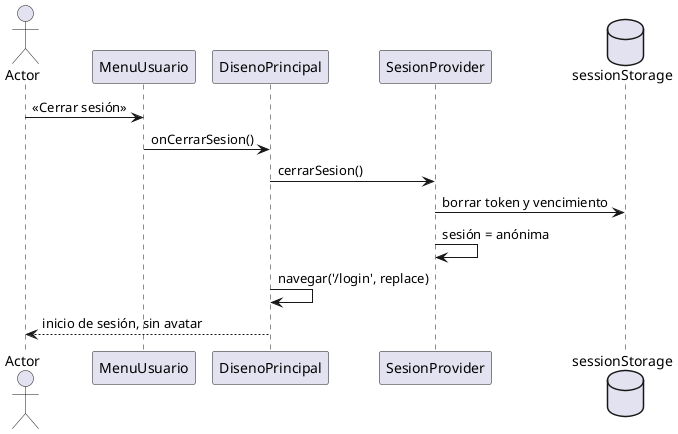

# CU «Cerrar sesión»

Fase de Construcción (RUP). Caso de uso implementado antes del plan del 60 % (DEC-54) y especificado en la revisión del 2026-11-12, que cierra HC1 para RF55. Describe lo que hace el prototipo; no agrega reglas.
- **Pantallas:** menú del avatar del encabezado de la plataforma (elementos comunes de WF-04 a WF-10).
- **Requisitos:** citados de `docs/srs/especificacion de requisitos.pdf`.
- **Decisiones:** en `docs/trazabilidad.md` (DEC-47 a DEC-50; «Pendientes»: el token no se revoca).
- **Contrato HTTP:** ninguno. El cierre es solo del cliente: no hay endpoint de cierre de sesión.

| Campo | Valor |
|---|---|
| **Caso de uso** | «Cerrar sesión» |
| **Actores** | Turista, Prestador, Gestor Turístico, Administrador |
| **Requisitos que traza** | RF55; RNF06 |
| **Nivel** | Objetivo de usuario |
| **Alcance** | Frontend (`SesionProvider`, `MenuUsuario`, `tokenSesion`) |

## Reglas de negocio (citadas del SRS)

- **RF55:** «El sistema debe permitir a cualquier usuario cerrar su sesión activa mediante un botón visible en el menú de navegación.»

Reglas que el SRS no fija y que decidió el equipo (`docs/trazabilidad.md`):
- El botón «Cerrar sesión» está en el menú del avatar del encabezado, al final de las opciones del rol.
- El token se descarta en el cliente (`sessionStorage`); ms-auth no lo revoca. Sigue siendo válido hasta su `exp` (como mucho 15 minutos, DEC-29) o hasta el próximo cambio de la cuenta (`ver`, ADR-008). Riesgo aceptado, registrado en «Pendientes».

## Diagrama de casos de uso

## CU «Cerrar sesión» (RF55)

**Actores:** Turista, Prestador, Gestor Turístico y Administrador.

**Precondiciones:**
1. El actor tiene una sesión iniciada (CU [«Iniciar sesión»](CU-iniciar-sesion.md)).

**Flujo básico:**
1. El actor abre el menú del avatar del encabezado.
2. Pulsa «Cerrar sesión».
3. El sistema borra el token y su vencimiento de `sessionStorage` y deja la sesión como anónima.
4. El sistema lleva al actor a «Inicio de sesión» (`/login`). El encabezado vuelve a mostrar el enlace «Inicio de sesión» y deja de mostrar el avatar.

**Flujos alternos:**
- **FA1. La sesión ya venció.** Si el token llegó a `expiraEn`, o una petición autenticada recibió 401 o 403 `CUENTA_INACTIVA`, la sesión ya se cerró sola y el sistema avisó por qué (DEC-48 a DEC-50); el avatar no se muestra y no hay nada que cerrar.

**Postcondiciones:**
- El navegador no conserva el token. Las rutas privadas vuelven a pedir el inicio de sesión.
- El token descartado sigue siendo válido en el servidor hasta su `exp` o hasta un cambio de la cuenta (pendiente conocido).

## Criterios de aceptación derivados

| # | Criterio | Prueba |
|---|---|---|
| C1 | «Cerrar sesión» está en el menú del avatar de todos los roles | `sesion.test.tsx`, `encabezadoSesion.test.tsx` |
| C2 | Al cerrar, el token sale de `sessionStorage`, el encabezado vuelve al estado anónimo y la pantalla pasa a `/login` | `sesion.test.tsx`, `encabezadoSesion.test.tsx` |

## Secuencia

## Fuera de alcance

- Revocar el token en el servidor (lista de tokens revocados o sesiones en ms-auth): «Pendientes».
- Cerrar la sesión en otros dispositivos o pestañas: cada pestaña tiene su propio `sessionStorage`.
