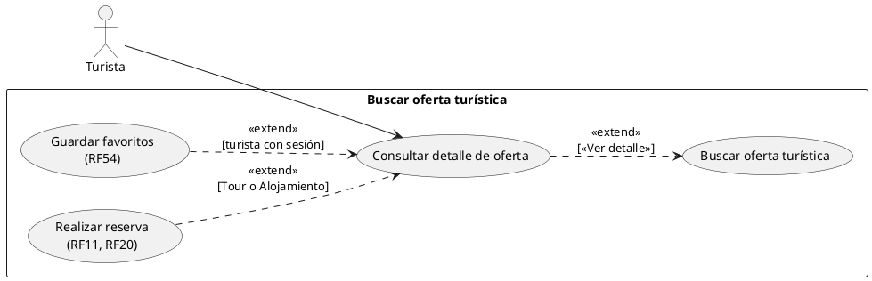
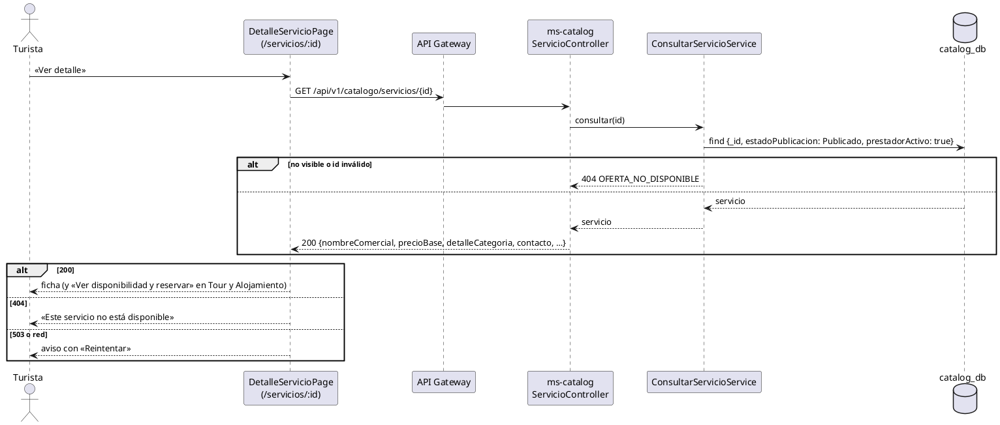

# Subsistema «Buscar oferta turística»: «Consultar detalle de oferta»

Fase de Construcción (RUP). Caso de uso implementado antes del plan del 60 % (DEC-54), ampliado en la iteración C (dirección, RNT y oferta, DEC-150, DEC-170) y especificado en la revisión del 2026-11-12, que cierra HC1 para la ficha de un servicio. Describe lo que hace el prototipo; no agrega reglas. La ficha de un atractivo tiene su propio CU: [«Consultar detalle de atractivo»](CU-consultar-detalle-atractivo.md).
- **Pantallas:** WF-06 «Detalle de lugar o servicio» (`/servicios/:id`, pública, con carga diferida).
- **Requisitos:** citados de `docs/srs/especificacion de requisitos.pdf`.
- **Decisiones:** en `docs/trazabilidad.md` (sección «WF-06 — Detalle de un servicio», con la política de visibilidad de DEC-22; DEC-150, DEC-170; «Consultar detalle de oferta — decisiones y hallazgos»).
- **Contrato HTTP:** en [`sad/api/ms-catalog.md`](../sad/api/ms-catalog.md), sección «Detalle público de un servicio».

| Campo | Valor |
|---|---|
| **Caso de uso** | «Consultar detalle de oferta» |
| **Actores** | Turista (y cualquier visitante sin sesión) |
| **Requisitos que traza** | RF37 (precio visible antes de reservar), RF58 (horario visible en la ficha), RF09, RF10, RF27 y RF43 (lectura de lo que registró el prestador), RF22 (visibilidad); RF54 (corazón de favoritos, con su propio CU) |
| **Nivel** | Objetivo de usuario |
| **Alcance** | `ms-catalog` (`catalog_db.servicios`) |

## Reglas de negocio (citadas del SRS)

- **RF37:** «El sistema debe capturar y mostrar el precio o rango de precio de cada servicio turístico registrado (RF09), independientemente de su categoría, visible para el Turista antes de confirmar una reserva.»
- **RF58:** los días y horarios de atención son «un campo de texto visible en la ficha de detalle para el Turista».
- **RF43:** los datos de contacto de atención al público que «visualizan los turistas en la plataforma» se mantienen vigentes.
- **RF22:** los servicios de un prestador Inactivo se ocultan de las búsquedas públicas.

Reglas que el SRS no fija y que decidió el equipo (`docs/trazabilidad.md`):
- **Visibilidad:** el detalle aplica la misma regla de la búsqueda (servicio Publicado de un prestador activo); si no, 404 `OFERTA_NO_DISPONIBLE`, sin decir por qué.
- **DEC-22:** todas las regiones de WF-06 aparecen en el orden del wireframe; lo que falta (dato ausente o función pendiente) tiene un único estado deshabilitado, sin texto visible de estado («—» o borde discontinuo y «No disponible» para lectores de pantalla).
- **DEC-170:** la dirección y el RNT del contacto muestran el valor del servicio, y «Horarios de atención» suma la oferta inicial (días de operación y, en Tour, salidas).
- **D2 de «Reservar servicio»:** «Ver disponibilidad y reservar» solo aparece en Tour y Alojamiento.

## Diagrama de casos de uso

## CU «Consultar detalle de oferta»

**Actor:** Turista o visitante sin sesión.

**Precondiciones:** ninguna; el detalle es público y no necesita token.

**Flujo básico:**
1. El actor pulsa «Ver detalle» en una tarjeta de servicio (WF-04 o WF-05), en la ventana de un marcador del mapa o en «Mis favoritos», o abre un enlace `/servicios/:id`.
2. El sistema consulta `GET /api/v1/catalogo/servicios/{id}`.
3. ms-catalog devuelve el servicio si está Publicado y su prestador está activo.
4. El sistema muestra, en el orden de WF-06: nombre y categoría; indicador de accesibilidad (un icono y un texto por condición declarada, RF27); corazón de favoritos; galería (la primera imagen como portada y hasta 4 miniaturas); descripción con los datos de la categoría (servicios incluidos de un alojamiento, datos del tour, de la gastronomía o del alquiler); contacto (teléfono, correo, dirección y RNT); región «Precio» con el precio «desde» y la tabla (las unidades del alojamiento con tipo, habitaciones, capacidad y precio por noche); y «Horarios de atención» con el texto del prestador y la oferta inicial.
5. En Tour y Alojamiento, el sistema muestra «Ver disponibilidad y reservar», que lleva a WF-10 (CU [«Realizar reserva»](CU-realizar-reserva.md)).
6. El actor puede volver a la búsqueda con sus filtros («Volver a la búsqueda»).

**Flujos alternos:**
- **FA1. Servicio no disponible.** 404 `OFERTA_NO_DISPONIBLE` (no existe, no está Publicado, el prestador está inactivo o el id no es un ObjectId): «Este servicio no está disponible», sin «Reintentar».
- **FA2. Catálogo no disponible.** 503 o error de red: aviso con «Reintentar».
- **FA3. Dato ausente.** Un campo que el servicio no trae (descripción, contacto, horario, dirección, RNT, accesibilidad, imágenes) queda en su región con el estado deshabilitado de DEC-22; sin imagen, la ilustración de la categoría.
- **FA4. Funciones pendientes.** Calificación (RF17), etiquetas, «Compartir», alerta de afluencia (RF39), WhatsApp, «Reportar información falsa» (RF57) y destinos alternativos (RF51) aparecen deshabilitados.

**Postcondiciones:** ninguna; el CU no cambia datos.

## Criterios de aceptación derivados

| # | Criterio | Prueba |
|---|---|---|
| C1 | Solo un servicio Publicado de un prestador activo; si no, 404 `OFERTA_NO_DISPONIBLE` | `ConsultarServicioServiceTest`, `ServicioApiIntegracionTest`, `VisibilidadPrestadorApiIntegracionTest` |
| C2 | El detalle trae precio, unidades, contacto, accesibilidad en el orden de RF27, horario, dirección, RNT y oferta | `ServicioApiIntegracionTest`, `DetalleCategoriaTest` |
| C3 | La pantalla muestra cada región en el orden de WF-06, con el estado deshabilitado único para lo que falta | `detalle.test.tsx` |
| C4 | «Ver disponibilidad y reservar» solo en Tour y Alojamiento | `detalle.test.tsx` |

## Secuencia

## Fuera de alcance

- Calificaciones y reseñas (RF17), afluencia (RF39), reportes (RF57) y destinos alternativos (RF51).
- Compartir la ficha: RF49 solo traza el botón de las reservas Completadas (DEC-81).
- Editar la galería del servicio (RF48).
