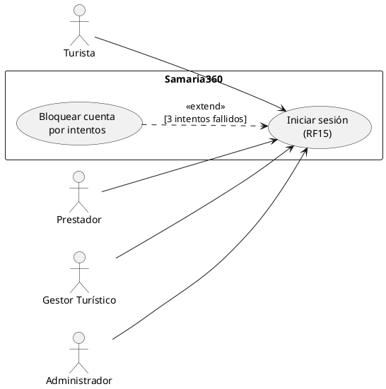
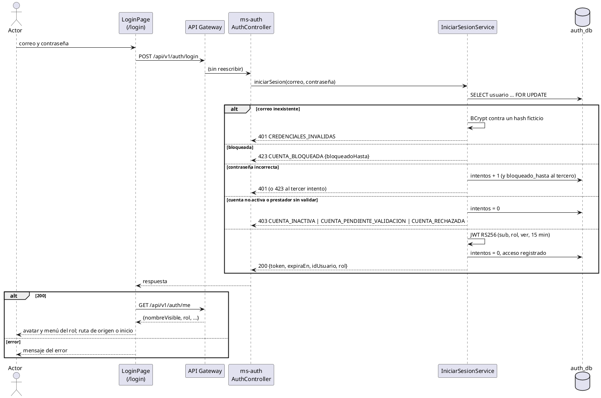

# CU «Iniciar sesión»

Fase de Construcción (RUP). Caso de uso implementado antes del plan del 60 % (DEC-54) y especificado en la revisión del 2026-11-12, que cierra HC1 para RF15. Describe lo que hace el prototipo; no agrega reglas.
- **Pantallas:** WF-01 «Inicio de sesión» (`/login`), con el encabezado y el pie reducidos.
- **Requisitos:** citados de `docs/srs/especificacion de requisitos.pdf`.
- **Decisiones:** en `docs/trazabilidad.md` (decisiones D1 a D6 de «Registrarse», en particular D3; DEC-29 y DEC-47 a DEC-50) y en [ADR-006](../sad/adr/ADR-006-registro-sin-enumeracion.md) y [ADR-008](../sad/adr/ADR-008-sincronizacion-estado-cuentas.md).
- **Contrato HTTP:** en [`sad/api/ms-auth.md`](../sad/api/ms-auth.md), secciones «Inicio de sesión», «Usuario autenticado» y «Token de sesión».

| Campo | Valor |
|---|---|
| **Caso de uso** | «Iniciar sesión» |
| **Actores** | Turista, Prestador, Gestor Turístico, Administrador |
| **Requisitos que traza** | RF15; RF22, RF62 (cuenta no activa), RF02 y RF28 (prestador sin validar); RNF05, RNF06 |
| **Nivel** | Objetivo de usuario |
| **Alcance** | `ms-auth` (`auth_db.usuario`, `prestador`); el JWT lo validan ms-catalog y ms-booking con el JWKS (ADR-005) |

## Reglas de negocio (citadas del SRS)

- **RF15:** «El sistema debe permitir a los usuarios (Turistas, Prestadores, Gestores y Administradores) iniciar sesión utilizando correo electrónico y contraseña, bloqueando la cuenta automáticamente por 15 minutos tras 3 intentos fallidos consecutivos.»
- **RF02:** la cuenta del prestador queda «Pendiente de Validación» hasta que el Administrador verifique sus credenciales.
- **RF22 y RF62:** el prestador Inactivo y el turista desactivado no pueden acceder.
- **RNF05:** contraseñas con BCrypt, nunca en texto plano.

Reglas que el SRS no fija y que decidió el equipo (`docs/trazabilidad.md`):
- **D3 (orden):** solo el bloqueo (423) se responde antes de verificar la contraseña; una contraseña incorrecta responde 401 con el mismo mensaje que un correo inexistente y suma un intento, sea cual sea el estado de la cuenta; el estado (403) solo se revela con la contraseña correcta, y entonces el conteo vuelve a 0.
- **ADR-006:** con un correo inexistente se compara igual un hash BCrypt ficticio, para que el tiempo de respuesta no revele qué correos existen. El 423 sí revela que la cuenta existe: riesgo residual aceptado (mitigación pendiente: límite de tasa en el gateway).
- **DEC-29:** el token vence a los 15 minutos y lleva el claim `ver`; no hay token de refresco («Pendientes»).
- **DEC-47 a DEC-50:** la sesión se guarda en `sessionStorage`; se cierra al llegar a `expiraEn`, con un 401 o con un 403 `CUENTA_INACTIVA` de una petición autenticada, y avisa por qué.

## Diagrama de casos de uso

- «Bloquear cuenta por intentos» es una extensión del propio RF15, no un CU del Entregable 1.

## CU «Iniciar sesión» (RF15)

**Actores:** Turista, Prestador, Gestor Turístico y Administrador.

**Precondiciones:**
1. El actor tiene una cuenta registrada (RF01, RF02) o creada por la semilla o desde la base de datos (Gestor, Administrador; DEC-25).
2. El actor no tiene una sesión iniciada en la pestaña (con sesión, `/login` lo lleva al inicio o a la ruta de origen).

**Flujo básico:**
1. El actor abre «Inicio de sesión» (desde la navegación o al pedir una ruta privada).
2. Escribe su correo y su contraseña y pulsa «Iniciar sesión».
3. El sistema valida en el cliente que los dos campos tengan valor y envía `POST /api/v1/auth/login`.
4. ms-auth busca la cuenta por el correo (sin mayúsculas ni espacios en los extremos) y bloquea su fila (`SELECT … FOR UPDATE`) hasta el final de la transacción.
5. La cuenta no está bloqueada y la contraseña coincide (BCrypt).
6. La cuenta está Activa y, si es de un prestador, validada.
7. ms-auth emite el JWT RS256 (`sub`, `rol`, `ver`, `iss`, `iat`, `exp` de 15 minutos), deja el conteo de intentos en 0, registra el acceso y responde 200.
8. El frontend guarda el token en `sessionStorage`, consulta `GET /api/v1/auth/me` y muestra el avatar con las iniciales y el menú de su rol.
9. El sistema lleva al actor a la ruta privada que pidió o al inicio (WF-04).

**Extensión «Bloquear cuenta por intentos»** (en el paso 5, con la contraseña incorrecta):
1. ms-auth suma un intento fallido.
2. Si es el tercero consecutivo, fija `bloqueado_hasta = ahora + 15 minutos` y responde **423 `CUENTA_BLOQUEADA`** con `bloqueadoHasta`; si no, **401 `CREDENCIALES_INVALIDAS`**.

**Flujos alternos:**
- **FA1. Correo inexistente o contraseña incorrecta.** 401 `CREDENCIALES_INVALIDAS` con el mismo mensaje en los dos casos (ADR-006). La pantalla muestra «Correo o contraseña incorrectos» sin decir cuál.
- **FA2. Cuenta bloqueada.** En el paso 5, antes de verificar la contraseña: 423 `CUENTA_BLOQUEADA` con la hora de desbloqueo. La pantalla la muestra en la hora local del navegador.
- **FA3. Cuenta no activa.** Con la contraseña correcta y `estado_cuenta` distinto de Activo (prestador Inactivo, RF22; turista Desactivado, RF62): 403 `CUENTA_INACTIVA`, sin token y con el conteo en 0.
- **FA4. Prestador sin validar o rechazado.** Con la contraseña correcta: 403 `CUENTA_PENDIENTE_VALIDACION` («Tu cuenta está en revisión por el administrador») o `CUENTA_RECHAZADA` (mensaje genérico; el motivo no se muestra, ver «Pendientes»), sin token y con el conteo en 0.
- **FA5. Datos incompletos.** El cliente marca el campo vacío sin enviar; si llega al servidor, 400 `DATOS_INVALIDOS` con `campos`.
- **FA6. Servicio no disponible.** 502, 503 o 504 (o `SERVICIO_NO_DISPONIBLE` del gateway): «El servicio no está disponible por el momento». Un 500 muestra el mensaje genérico.

**Postcondiciones:**
- **Éxito:** el actor tiene un token vigente por 15 minutos y ve los menús de su rol (RNF06). El conteo de intentos está en 0 y el acceso queda registrado.
- **Fallo:** no se emite token. Con una contraseña incorrecta, el conteo sube y, al tercer intento, la cuenta queda bloqueada 15 minutos.

## Criterios de aceptación derivados

| # | Criterio | Prueba |
|---|---|---|
| C1 | Con credenciales correctas y la cuenta Activa se emite un JWT con `sub`, `rol` y `ver` que vence a los 15 minutos | `IniciarSesionServiceTest`, `IniciarSesionIntegracionTest` |
| C2 | Tres contraseñas incorrectas consecutivas bloquean la cuenta 15 minutos (el reloj sale de `RelojPort`) | `PoliticaBloqueoTest`, `IniciarSesionServiceTest`, `IniciarSesionIntegracionTest` |
| C3 | Correo inexistente y contraseña incorrecta responden el mismo 401 | `IniciarSesionServiceTest`, `IniciarSesionIntegracionTest` |
| C4 | La cuenta bloqueada responde 423 antes de verificar la contraseña | `IniciarSesionServiceTest`, `PoliticaBloqueoTest` |
| C5 | Cuenta inactiva, prestador pendiente o rechazado: 403 solo con la contraseña correcta, sin token y con el conteo en 0 | `PoliticaAccesoTest`, `IniciarSesionServiceTest`, `IniciarSesionIntegracionTest` |
| C6 | La pantalla muestra cada error, redirige tras el login y guarda la sesión en `sessionStorage` | `inicioSesion.test.tsx`, `sesion.test.tsx`, `encabezadoSesion.test.tsx`, `sesionVencimiento.test.tsx` |

## Secuencia

## Fuera de alcance

- Recuperar la contraseña (RF34): el enlace «¿Olvidaste tu contraseña?» está deshabilitado.
- Token de refresco y revocación del token al cerrar sesión («Pendientes»).
- Límite de tasa en el gateway (mitigación pendiente de ADR-006).
