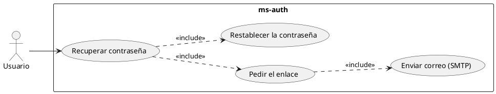

# CU «Recuperar contraseña»

Fase de Construcción (RUP), plan del 100 %, iteración F (PR F1). Describe lo que hace el prototipo; las reglas que el SRS no fija las decidió el equipo el 2026-11-14 (DEC-285).
- **Pantallas:** WF-01 («¿Olvidaste tu contraseña?»), WF-27 «Recuperar contraseña» (`/recuperar`) y WF-28 «Restablecer contraseña» (`/restablecer`), propuestas por arquitectura; encabezado y pie reducidos.
- **Decisiones:** [`trazabilidad/decisiones-plan-100-iteracion-f.md`](../trazabilidad/decisiones-plan-100-iteracion-f.md) (DEC-285 a DEC-290) y [ADR-006](../sad/adr/ADR-006-registro-sin-enumeracion.md) (respuesta uniforme).
- **Contrato HTTP:** [`sad/api/ms-auth.md`](../sad/api/ms-auth.md), sección «Recuperación de contraseña (RF34)».

| Campo | Valor |
|---|---|
| **Caso de uso** | «Recuperar contraseña», con los pasos «Pedir el enlace» y «Restablecer la contraseña» |
| **Actores** | Cualquier usuario con cuenta (Turista, Prestador, Gestor o Administrador), sin sesión |
| **Requisitos que traza** | RF34; RF03 (idioma del correo); RF15 (quita el bloqueo); RNF05 (BCrypt) |
| **Nivel** | Objetivo de usuario |
| **Alcance** | `ms-auth` (`auth_db.token_recuperacion`, `usuario`, outbox) y el servidor SMTP (Mailpit en desarrollo, Gmail en la demo) |

## Reglas de negocio

- **RF34 (SRS):** «El sistema debe permitir a cualquier usuario recuperar el acceso a su cuenta mediante un enlace de restablecimiento de contraseña enviado a su correo electrónico registrado, el cual expirará 30 minutos después de haber sido generado.»
- **Decisiones del equipo, no del SRS (DEC-285):**
  - la respuesta de «pedir el enlace» es la misma exista o no la cuenta (ADR-006);
  - el enlace sirve **una sola vez**; un pedido nuevo anula los anteriores; solo se guarda el **SHA-256** del token;
  - restablecer **quita el bloqueo de RF15** (intentos en 0) y **cierra las sesiones abiertas** (`version_cuenta + 1` y el evento `CuentaActualizada`, ADR-008);
  - aplica a **todas** las cuentas: el inicio de sesión ya decide los 403 de una cuenta Pendiente, Rechazada o Inactiva;
  - límite de tasa en el gateway: 5 pedidos cada 10 minutos por conexión, para los dos pasos.

## Diagrama de casos de uso

## Flujo básico

1. En WF-01 el usuario elige «¿Olvidaste tu contraseña?» y llega a WF-27.
2. Escribe su correo y elige «Enviar enlace». El cliente envía `POST /api/v1/auth/recuperacion` con el correo y el idioma de la interfaz.
3. ms-auth valida el formato. Si el correo tiene cuenta, guarda el hash de un token nuevo que vence a los 30 minutos (anula los anteriores) y envía, en otro hilo, un correo con el enlace `/restablecer#token=…`.
4. ms-auth responde 202 `RECIBIDO`; WF-27 muestra el mensaje uniforme.
5. El usuario abre el enlace. WF-28 lee el token del fragmento y lo quita de la URL.
6. Escribe la contraseña nueva dos veces y elige «Guardar contraseña». El cliente valida el mínimo de 8 caracteres y que coincidan, y envía `POST /api/v1/auth/recuperacion/restablecimiento`.
7. ms-auth valida la contraseña y, en una transacción, marca usado el token, cambia la contraseña (BCrypt), quita el bloqueo, sube `version_cuenta` y encola `CuentaActualizada` para ms-catalog, ms-booking y RabbitMQ. Responde 204.
8. WF-28 confirma el cambio y ofrece «Iniciar sesión».

## Flujos alternativos

- **FA1 — Correo sin cuenta (paso 3):** no se guarda ni se envía nada; la respuesta es la misma (ADR-006).
- **FA2 — Correo mal formado (paso 3):** 400 `DATOS_INVALIDOS` con `campos.correo`; WF-27 marca el campo.
- **FA3 — Enlace usado, vencido o inválido (paso 7):** 400 `TOKEN_INVALIDO` (un solo código para los tres casos); WF-28 ofrece «Pedir otro enlace». Sin token en el enlace, WF-28 lo muestra sin formulario.
- **FA4 — Contraseña inválida (paso 7):** 400 `DATOS_INVALIDOS` con `campos.contrasena`; el token **no** se gasta.
- **FA5 — Demasiados pedidos:** el gateway responde 429 `DEMASIADAS_SOLICITUDES` con `Retry-After`.
- **FA6 — SMTP caído (paso 3):** la respuesta no cambia; el fallo queda en el log con el id del usuario, sin la dirección ni el token. El usuario puede pedir otro enlace.

## Poscondiciones

- **Éxito:** la contraseña cambió; los tokens del usuario quedaron usados; la cuenta no tiene bloqueo; los tokens JWT anteriores reciben 401 `SESION_INVALIDADA` en ms-catalog y ms-booking cuando llega el evento (ADR-008).
- **Fallo:** nada cambia; el token sigue vigente si el fallo fue de la contraseña.

## Fuera de alcance

- Notificar el cambio de contraseña por otros canales (sin RF).
- Cambiar la contraseña con la sesión iniciada (sin RF; RF53 no la incluye, DEC-79).
