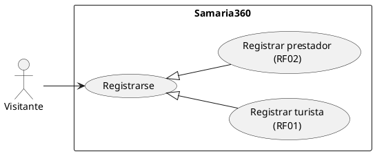
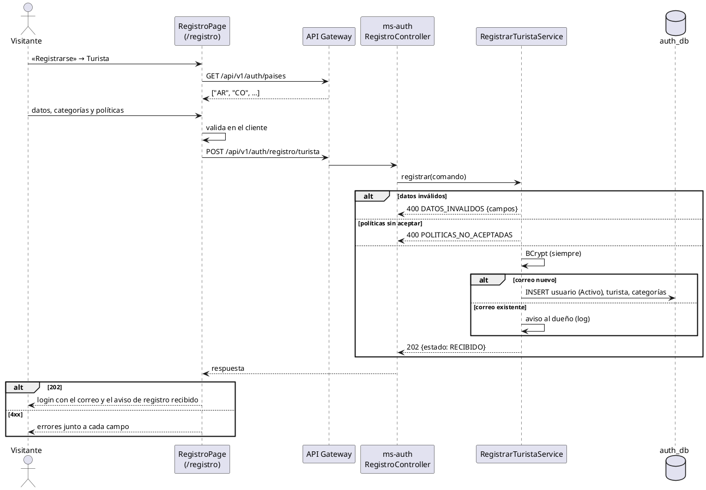

# CU «Registrarse»

Fase de Construcción (RUP). Caso de uso implementado antes del plan del 60 % (DEC-54) y especificado en la revisión del 2026-11-12, que cierra HC1 para RF01 y RF02. Describe lo que hace el prototipo; no agrega reglas.
- **Pantallas:** WF-02 «Registro de turista» y WF-03 «Registro de prestador», en una sola ruta (`/registro`) con la elección del tipo de cuenta; encabezado y pie reducidos.
- **Requisitos:** citados de `docs/srs/especificacion de requisitos.pdf`.
- **Decisiones:** en `docs/trazabilidad.md` («Registrarse — decisiones», D1 a D6) y en [ADR-006](../sad/adr/ADR-006-registro-sin-enumeracion.md).
- **Contrato HTTP:** en [`sad/api/ms-auth.md`](../sad/api/ms-auth.md), secciones «Registro» y «Países y clave pública».

| Campo | Valor |
|---|---|
| **Caso de uso** | «Registrarse», con las variantes «Registrar turista» y «Registrar prestador» |
| **Actores** | Visitante (futuro Turista o Prestador) |
| **Requisitos que traza** | RF01, RF02; RF03 (nombres de los países en el idioma activo); RF46 (enlace a la política de privacidad); RNF05 |
| **Nivel** | Objetivo de usuario |
| **Alcance** | `ms-auth` (`auth_db.usuario`, `turista`, `turista_categoria_interes`, `prestador`) |

## Reglas de negocio (citadas del SRS)

- **RF01:** «El sistema debe permitir el registro de turistas, capturando obligatoriamente primer nombre, primer apellido, correo electrónico, contraseña, país de origen, tres categorías de interés turístico (ej. naturaleza, cultura, aventura), requiriendo la aceptación de políticas de privacidad y opcionalmente segundo nombre y apellido.»
- **RF02:** «El sistema debe permitir el registro de prestadores de servicios, capturando los datos organizacionales iniciales: nombre del representante legal, Registro Nacional de Turismo (RNT), correo electrónico corporativo, teléfono y contraseña. La cuenta quedará en estado "Pendiente de Validación" hasta que el Administrador verifique sus credenciales.»
- **RNF05:** contraseñas con BCrypt, nunca en texto plano.

Reglas que el SRS no fija y que decidió el equipo (`docs/trazabilidad.md`):
- **D1:** las «tres categorías» son el vocabulario cerrado (Naturaleza, Cultura, Aventura); el turista elige **al menos una**, sin repetir. Confirmada por el equipo el 2026-11-13 (DEC-262).
- **D2:** la razón social es opcional y no está en el formulario; el correo corporativo es también la credencial de acceso.
- **D4 y ADR-006:** respuesta uniforme 202 exista o no el correo, con BCrypt siempre y sin inicio de sesión automático; el RNT duplicado sí responde 409 (es un dato público).
- **D5:** el país se guarda como código ISO 3166-1 alfa-2; el frontend pone los nombres.
- **D6:** la aceptación de las políticas es obligatoria también para el prestador (requisito derivado de WF-03), con el mismo código de error.

## Diagrama de casos de uso

## CU «Registrarse» (RF01, RF02)

**Actor:** Visitante sin sesión.

**Precondiciones:**
1. El visitante no tiene una sesión iniciada.

**Flujo básico (turista, RF01):**
1. El visitante abre «Registrarse» desde la pestaña de «Inicio de sesión» y elige «Turista».
2. El sistema carga los países (`GET /api/v1/auth/paises`) y los muestra con su nombre en el idioma activo, ordenados.
3. El visitante escribe primer nombre, primer apellido, correo y contraseña (y, si quiere, segundo nombre y segundo apellido), elige su país y al menos una categoría de interés, y acepta la política de privacidad.
4. El sistema valida en el cliente con los mismos criterios y códigos que el servidor y envía `POST /api/v1/auth/registro/turista`.
5. ms-auth valida todos los campos a la vez y después la aceptación de las políticas.
6. Si el correo no existe, crea la cuenta **Activa** con la contraseña en BCrypt, sus categorías y la aceptación de las políticas, en una transacción.
7. ms-auth responde **202 `{"estado": "RECIBIDO"}`**.
8. El sistema vuelve a «Inicio de sesión» con el correo escrito y el aviso «Registro recibido. Inicia sesión con tu correo», sin iniciar la sesión.

**Flujo básico (prestador, RF02):**
1. El visitante elige «Prestador de Servicios».
2. Escribe el nombre del representante legal, el RNT, el correo corporativo, el teléfono y la contraseña, y acepta la política de privacidad. El formulario avisa que la cuenta quedará pendiente de validación.
3. El sistema valida en el cliente y envía `POST /api/v1/auth/registro/prestador`.
4. ms-auth valida los campos, después las políticas y después que el RNT no exista.
5. Si el correo no existe, crea la cuenta con `estado_validacion = Pendiente`; el correo corporativo es también la credencial (D2).
6. ms-auth responde **202 `{"estado": "RECIBIDO"}`** y el sistema vuelve a «Inicio de sesión» con «Solicitud recibida; quedará pendiente de validación».

**Flujos alternos:**
- **FA1. Datos inválidos.** 400 `DATOS_INVALIDOS` con un código por campo (`REQUERIDO`, `FORMATO`, `LONGITUD_MINIMA`, `LONGITUD_MAXIMA`, `NO_PERMITIDO`, `DUPLICADO`). Cada error va junto a su campo, el foco va al primero y un resumen se anuncia en `role="alert"`. No se guarda nada.
- **FA2. Políticas no aceptadas.** Con los datos válidos: 400 `POLITICAS_NO_ACEPTADAS`, en la casilla.
- **FA3. Correo ya registrado.** El mismo 202 del flujo básico (ADR-006): no se crea nada y `NotificadorCuentaPort` deja un aviso para el dueño de la cuenta (hoy solo un log con el id; el envío por correo llega con RF34). El visitante no sabe si el correo existía.
- **FA4. RNT ya registrado** (solo prestador). 409 `RNT_YA_REGISTRADO`, en el campo del RNT.
- **FA5. Países no disponibles.** Si `GET /paises` falla, el selector avisa y permite reintentar.
- **FA6. Servicio no disponible.** 502, 503 o 504: aviso general sin perder lo escrito.

**Postcondiciones:**
- **Turista:** cuenta Activa; puede iniciar sesión (CU [«Iniciar sesión»](CU-iniciar-sesion.md)).
- **Prestador:** cuenta Pendiente de Validación; el login responde 403 `CUENTA_PENDIENTE_VALIDACION` hasta que el Administrador la apruebe (CU [«Administrar cuentas»](CU-administrar-cuentas.md), RF28).
- **Correo existente o error:** no cambia nada en `auth_db`.

## Criterios de aceptación derivados

| # | Criterio | Prueba |
|---|---|---|
| C1 | Turista válido: cuenta Activa con sus categorías y la contraseña en BCrypt | `RegistrarServiceTest`, `RegistroApiIntegracionTest` |
| C2 | Prestador válido: cuenta Pendiente; no inicia sesión hasta la validación | `RegistroApiIntegracionTest`, `IniciarSesionIntegracionTest` |
| C3 | Correo repetido: el mismo 202 que un correo nuevo, sin crear nada | `RegistrarServiceTest`, `RegistroApiIntegracionTest` |
| C4 | Errores por campo con los nombres JSON, todos a la vez; políticas después de los datos | `RegistroTest`, `ValoresRegistroTest`, `RegistroApiIntegracionTest` |
| C5 | Categorías: al menos una, sin repetir, del vocabulario cerrado (CHECK V4) | `RegistroTest`, `MigracionesRegistroIntegracionTest` |
| C6 | RNT repetido: 409 `RNT_YA_REGISTRADO` | `RegistroApiIntegracionTest` |
| C7 | La pantalla valida como el servidor, muestra cada error en su campo y vuelve al login sin iniciar sesión | `validacionRegistro.test.ts`, `registro.test.tsx` |

## Secuencia (turista)

## Fuera de alcance

- Verificar el correo y enviar el aviso de cuenta existente por correo (RF34, ms-notificaciones).
- Iniciar la sesión automáticamente después del registro (ADR-006).
- Registrar la razón social en el formulario (D2).
